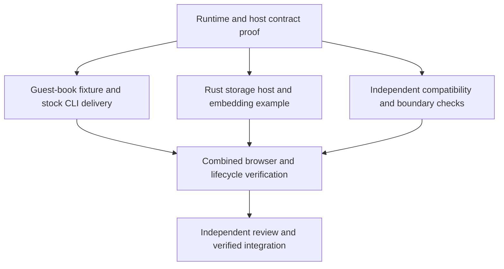

# A Weekend Build Mandate for the Remix Guest Book

## Summary

Build Bento's first executable milestone: the same `remix@3.0.0` guest book served by the Bento CLI and an in-process Rust host. The embedded application uses a host-only storage API. A bounded mandate delegates implementation decisions and verified integration without repeated human approval.

## Authorization

On 2026-10-10, Mark explicitly authorized writing this umbrella proposal, requested the exact `remix@3.0.0` release, and approved Beads coordination with isolated `../.worktrees/bento-*` worktrees. He suggested the existing guest book as a smaller specimen than contacts. He will review, request revisions, and approve the proposal before setting an OMP `/goal` for implementation.

This is authorization to prepare the proposal and its draft PR, not authority to implement the runtime or merge the completed feature. The separate authorization to configure unattended `gh-agent` authentication has been exercised. The Build mandate below remains inactive until the human records approval of a specific revision and resolves the open spending question.

## Motivation

Bento currently has a vision, a proposed architecture, and development-process tooling, but no Rust runtime implementation. Its principal claim needs one concrete demonstration: application code executes through the same runtime in a standalone process and inside a native host, while the native host controls capabilities unavailable to the standalone application.

A guest book is small enough to inspect but exercises more than an evaluation demo: npm resolution, server components, streamed responses, forms, persistence, browser assets, and asynchronous execution. Reusing an existing application gives compatibility an external reference. Running it only in a subprocess, replacing Remix with a lookalike, or dropping its browser behavior would leave the embedding claim unproven.

Repeated per-feature approval would make the human the scheduler for overnight work. This proposal fixes the outcome and boundaries once, while leaving the strategist responsible for technical decisions, evidence, worker coordination, and integration inside them.

## Domain grounding

### Established context

- The [published `remix@3.0.0` manifest](https://registry.npmjs.org/remix/3.0.0) declares ESM and a Node engine floor of `>=24.3.0`. Its runtime exports are subpaths such as `remix/router` and `remix/component`; the root export is types-only. This is Remix 3, not a React Router or Remix 2 application.
- The exact-release [Railway/Deno guest book](https://github.com/pitlane-tools/templates/tree/8d838f3ea3b7a00f3e906e3e7dcd039ca911a5b8/railway-deno) uses a Fetch-style router, `Request`/`Response`, form-data and async-context middleware, server-rendered components, a hydrated character counter, static assets, and `node:sqlite`. Its request-time persistence surface is listing entries and appending an entry.
- The local unbundled template is pinned to `3.0.0-rc.1` and uses removed `remix/ui` exports. It also invokes `remix/node-tsx` and request-time asset compilation. [The released loader](https://cdn.jsdelivr.net/npm/@remix-run/node-tsx@1.0.0/dist/index.js) uses Node's `registerHooks`; [the asset package](https://cdn.jsdelivr.net/npm/@remix-run/assets@1.0.0/package.json) depends on npm compiler bindings. Neither is a prerequisite for serving an application whose assets were prepared beforehand.
- Deno's [version-pinned worker interface](https://github.com/denoland/deno/blob/v2.9.7/runtime/worker.rs) accepts extensions, a module loader, Node services, and a permission container. These are embedding seams, not a complete npm-aware embedding implementation. Its [runtime assembly](https://github.com/denoland/deno/blob/v2.9.7/runtime/Cargo.toml) is broad and rapidly evolving. The coherent reference versions are `deno_runtime 0.267.0` and `deno_core 0.412.0`; no Bento build against them has yet been demonstrated.
- [Deno's permission options](https://github.com/denoland/deno/blob/v2.9.7/runtime/permissions/lib.rs) distinguish scoped filesystem, network, environment, process, import, and FFI access. A host must also enforce its own custom operations in native code. Hiding a JavaScript wrapper does not enforce authority.

### Relevant constraints and principles

The application, runtime instance, and host have different lifetimes. A guest-book database belongs to its host or application storage adapter; destroying an isolate must not erase its entries. A host module's availability is separate from permission to call its operations. Package installation and browser-asset preparation precede execution; serving requests must not install packages or invoke a compiler subprocess.

The public embedding contract belongs to Bento. It must not require callers to own Deno CLI internals, raw engine handles, or a child JavaScript-runtime process. Reusing an upstream assembly is acceptable; claiming every bundled API or engine is compatible is not.

### Quality bar

The original browser interaction and plain HTML form submission both work. The same application and pinned runtime dependencies run under both hosts. The embedding demonstrably calls Rust-owned functionality, persists data, rejects unauthorized access, and shuts down without leaving a listener alive. Every compatibility claim names its tested platform and surface.

### Remaining uncertainty

The Deno-derived assembly has not been compiled into Bento. Bootstrap/snapshot configuration, resolver integration, async-context behavior, request/response streaming, and interruption of an executing isolate need direct evidence. The first implementation gate resolves these integration risks before broad worker fan-out. Failure permits another in-scope assembly or compatible dependency pin, not a subprocess engine, weaker permissions, or a smaller promised application.

## Existing baseline

The reference is `railway-deno` from `pitlane-tools/templates` at commit `8d838f3ea3b7a00f3e906e3e7dcd039ca911a5b8`, also present under `~/Developer/Templates/pitlane-templates`. Its lockfile resolves `remix@3.0.0`, `@pitlane/vite-plugin-remix@0.8.0`, `@pitlane/assets@0.1.0`, `@pitlane/theme@0.5.0`, and Vite `8.2.2`.

During proposal preparation, an isolated copy was installed from the frozen lockfile, migrated, built, and exercised on Deno `2.9.7` on macOS arm64. The build emitted `dist/ssr/index.mjs`, an asset manifest, CSS, and browser JavaScript. Chromium rendered the guest book, updated the live remaining-character counter, submitted an entry, displayed it, and reset the form without browser errors. A plain form POST returned HTTP `302` with `Location: /`. Both entries survived a server-process restart using the same SQLite file.

The restarted reference also worked with cached-only dependencies, no permission prompts, reads limited to the copied project, writes limited to its database directory, environment access limited to `DATABASE_URL` and `NODE_ENV`, and network access limited to its loopback endpoint. This proves the reference application can run under a scoped Deno configuration. It does not prove Bento compatibility, Rust embedding, or a complete security boundary.

The template's documented start task has an existing [port-expansion defect](https://github.com/pitlane-tools/templates/issues/11); its artifact path also names `index.js` rather than the observed `index.mjs`. The baseline was served with an explicit command targeting the actual artifact. Additional evidence was [recorded on the existing issue](https://github.com/pitlane-tools/templates/issues/11#issuecomment-6101004128). Fixing the original template repository is outside this proposal. Bento's copied fixture must have correct preparation and launch instructions.

Preserve the guest book's router, form workflow, rendering, browser enhancement, and persistence. Change its storage seam and host entrypoints deliberately. Do not reproduce a general SQL driver with only two working operations. The original local examples and their databases remain untouched.

## Proposed solution

Deliver a V8-backed Rust runtime, a thin Bento CLI, and a Rust embedding example that serve one guest-book fixture derived from the exact-release baseline. Prepare browser assets with the existing toolchain. Adapt the application to a small guest-book store interface: the stock CLI uses a real SQLite-backed JavaScript adapter, while the embedded application imports a host-registered module backed by Rust-owned SQLite storage.

This is the first executable milestone toward the vision's broader MVP. Integrated package installation, type checking, formatting, linting, bundling, development serving, and additional engines remain outside this mandate. The architecture's separation between runtime and development tooling remains intact.

## Detailed design

### Application and preparation boundary

Place the derived application and its reproducible preparation instructions in the Bento repository, with attribution to the pinned source. Preserve the released `remix@3.0.0` package unchanged and lock its transitive dependency graph. Use ordinary manifests and lockfiles for the copied fixture; do not add Remix-specific cases to Bento's resolver. Preparation may use existing package-management and asset-build tools, but these tools are not dependencies of the executing runtime library.

The prepared application includes the server module graph, local npm dependencies it still imports, generated asset manifest, browser JavaScript, CSS, and public assets. A fresh preparation reproduces the application without depending on the original checkout, its `.env`, its database, or a developer's global package cache. The build manifest determines artifact names; instructions must match actual output.

Runtime execution performs no dependency installation, registry lookup, remote module download, or request-time asset compilation. Missing packages or assets produce actionable errors. A runtime-only environment without Node, Deno, Bun, or a package manager must serve both previews from the prepared files.

### Observable guest-book behavior

Both hosts serve the same router, controller, server components, and browser components. The page displays persisted guest-book entries, a required name field, a required message field, the existing remaining-character indicator, and the Sign action. Typing updates the hydrated indicator. Submitting creates one entry, redirects to `/` using the reference's HTTP `302` behavior, displays the saved entry, and clears the form. The plain form submission path also works with JavaScript disabled.

Preserve the reference's field validation and rendering behavior rather than inventing a new validation policy. Persist `id`, `name`, `message`, and `createdAt`. Entries survive runtime recreation and host-process restart when the same database is supplied. Store adapters present the same application-facing types; any native wire representation of a timestamp is converted at the adapter boundary. Do not silently replace persistent storage with an in-memory demo.

Frame-targeted rendering and the browser asset graph remain functional. Browser verification must exercise the hydrated character counter and submission, not merely fetch server HTML. Contacts, additional routes, authentication, multi-user tenancy, and a visual redesign are excluded.

### Shared runtime and CLI

The CLI and Rust example link the same Bento runtime implementation. The runtime loads ordinary ESM, resolves the package exports and Node built-ins needed by the pinned application, and executes TypeScript with a native transform path. A separate TypeScript entry fixture must exercise type-bearing source and asynchronous execution; serving precompiled JavaScript alone is insufficient evidence of TypeScript execution. Semantic type checking is not claimed.

The initial CLI surface is `bento run <entry>` for module execution and `bento serve <entry>` for a module whose default export supplies a Fetch-compatible `fetch` handler. `serve` loads the application before reporting readiness, accepts an explicit loopback listen address and port, and uses the same construction, evaluation, event-loop, and shutdown machinery as embedding. Configuration and uncaught guest failures exit unsuccessfully with context; unsupported options must not be accepted as no-ops.

The CLI exposes explicit scoped read, write, network, and environment grants. It does not grant process execution, FFI, native-addon loading, remote imports, or broad filesystem access by default. Selecting an entrypoint or listen address is not permission to read arbitrary files or access arbitrary network destinations. Runtime permissions never prompt interactively.

Bento owns module identity and resolution at its boundary. Reuse upstream resolver implementations for package semantics; do not hard-code this fixture's import names or flatten its dependencies into hand-written substitutes. Support only the tested compatibility subset and document its boundaries. A Deno reference assembly is permitted initially, including its dependency footprint, without claiming per-extension minimal builds or full Deno/Node compatibility.

### Embedding and host-only APIs

A Rust application constructs and drives the runtime in its own process. The public API supports loading the entry module, supplying host modules and capability grants, serving the application, observing failures, requesting shutdown, and disposing of runtime-owned resources. Public types must not expose engine handles or require spawning the Bento CLI, Node, Deno, or Bun.

The host registers an application-specific module, `host:guestbook`, before guest execution. Its asynchronous exports list entries and append a validated entry. The module calls real Rust-owned storage code against a host-selected SQLite database. It does not accept an arbitrary database path or SQL statement from JavaScript. The shared application depends on a small store interface; stock and embedded entrypoints supply different adapters without duplicating the router or UI.

Host-module registration and grants are per runtime instance. A stock CLI instance has no `host:guestbook` registration and rejects an attempted import clearly, without package or network fallback. An embedded read-only instance can import the module and list entries, but append fails at the Rust boundary and leaves the database unchanged. Removing only a JavaScript wrapper is not an acceptable denial mechanism. A second runtime in the same Rust process does not inherit another instance's bindings or grants.

The embedding example must demonstrate a successful browser submission through the Rust store, inspect the resulting persisted record from Rust, dispose of the runtime, and create another runtime that reads the same stored entry. The host retains ownership of its database across runtime disposal and closes it at host shutdown. No partial implementation of Remix's general-purpose `DatabaseDriver` is introduced to impersonate compatibility.

### Capabilities and lifecycle

Filesystem and module reads are limited to the prepared application, its declared dependency roots, and explicitly granted resources. Canonical path and symlink handling must not turn an allowed root into access to an unrelated file. The custom host database need not be exposed as a guest-readable or guest-writable filesystem path. Environment grants name individual variables. Network grants identify permitted endpoints; outbound access outside them is denied. Subprocess and FFI attempts are denied in this milestone.

Exercise denials through the actual native operations, including available Node-compatible APIs. Distinguish an unavailable host module, a denied operation, an unresolved package, and a guest exception in host-observable errors. Do not silently return an empty value or pretend an operation succeeded. These controls are not a claim of hostile-code isolation; OS sandboxing, native-code threats, and comprehensive resource quotas remain outside this milestone.

Shutdown stops accepting new requests, drains or cancels pending guest work, releases runtime-owned resources, and returns an observable result. Use a bounded shutdown deadline, initially five seconds. An uncooperative synchronous guest must not prevent the host regaining control indefinitely: interrupt and dispose of that runtime, report the interruption, and do not reuse its guest state. A failed or timed-out shutdown cannot report graceful success. After disposal, the old listener must not serve requests and a replacement runtime must be able to bind the same port. Retained host data remains intact.

### Implementation gates and independent slices

The umbrella proposal supplies product intent for the named work. Beads tasks reference it directly; a proposal per task is unnecessary. A material in-scope design decision may receive a child proposal or architectural decision before its implementation, under the delegated authority below.

First, one owner establishes the Rust workspace, coherent dependency pins, public runtime/host boundary, loader, capability wiring, and lifecycle. The feasibility gate must actually compile and execute TypeScript, import the released Remix router through real package resolution, serve a response, call a custom async host operation, deny an unauthorized operation, and stop the listener. The gate is an implementation dependency, not permission to ship a smaller substitute for the guest book.

Only after those contracts and evidence exist does the coordinator fan out the following file-disjoint work. All implementation, including the foundation, follows tests, then applicable guides, then code; the coordinator schedules red/green execution and shared gates.

The fixture/CLI owner owns application JavaScript, its adapters, preparation, browser assets, and the Rust `bento run`/`bento serve` binary. The embedding owner owns the Rust example and host storage implementation against the agreed registration contract. The compatibility owner owns cross-host and negative-case checks, without rewriting production behavior. The coordinator retains ownership of the shared runtime implementation, manifests, lockfiles, public contract changes, cross-artifact agreement, and integration. A shared-contract change pauses dependent work and updates the handoff before coding continues.

### Beads, worktrees, and integration

After approval, create the work graph in Beads with dependencies, acceptance evidence, file ownership, branch/worktree identity, and the approved mandate revision. Use separate `../.worktrees/bento-<slice>` worktrees and distinct branches. The current proposal branch is the integration branch for PR #1. Do not alter other projects' worktrees or borrow their databases, configuration, or credentials.

The installed Beads database uses the embedded single-writer backend. The coordinator serializes Beads mutations, records worker ownership and active leases, and stores durable handoffs and blockers. Every worker brief explicitly prohibits direct Beads mutations, including claims, heartbeats, closure, and persistent-memory writes; workers request these through the coordinator instead of following the repository's generic Beads examples independently. Workers communicate through the harness; the coordinator persists decisions and evidence in Beads and the relevant PR. A lease expiring is not proof that a worker stopped. Inspect the worker and its worktree before reassignment, preserving completed changes.

Workers do not merge, change credentials, publish artifacts, or commit on the coordinator's behalf. They return bounded changes and evidence requests. The coordinator runs the required checks, reviews the changes, commits coherent units, and pushes their explicit branches. Integration uses reviewed PRs into the integration branch, followed by the final reviewed PR into `main`. No direct push to `main`, force-push, or branch deletion is authorized.

One integration owner serializes merges and verifies the latest combined candidate. A green worker branch is not proof of the integrated application. Material disputed findings, missing promised behavior, and red checks block acceptance. Legitimate defects needed for this outcome are fixed, not filed away as future work.

### Unattended execution and recovery

Use OMP `/goal` with ordinary workers. `/goal` and `/vibe` are alternatives; this mandate does not depend on combining them. Before the human leaves, verify the active mandate, available authentication lifetime, a running interactive OMP session, machine wakefulness, and one worker-to-review-to-integration cycle. Keep at most four workers active and at most two heavy build/test jobs running in total, including at most one Rust dependency build against a shared target directory. Reduce concurrency under resource pressure rather than changing the acceptance criteria.

The coordinator uses `GH_AGENT_UNATTENDED=1 gh-agent ...` for its issue and PR comments. The installed helper obtains the expiring 1Password service-account token from login Keychain and does not fall back to interactive authentication on failure. Following the existing identity policy, plain `gh` deliberately uses the human's standing personal login for reads, PR creation, and authorized merges; Git commits and pushes also retain the human's identity. This personal access is separate from the expiring service account and is not technically revoked by its expiry. The coordinator enforces the mandate and authentication stop conditions across both identities rather than treating credential possession as authorization. Credential values are never placed in Beads, source files, worker briefs, or logs. Same-user workers are not a security isolation boundary; this arrangement relies on the human's explicit trust in the coordinator and existing App authority.

The provisioned service account expires approximately 2026-10-12 at 18:30 UTC. Its lifetime is independent of the mandate. Before activation, confirm it covers the intended unattended window or renew it with the human present and explicitly authorizing renewal. No autonomous credential renewal or authority expansion is granted. If credentials expire during work, the coordinator blocks remote actions under either identity, even if personal authentication still works, records the cause, and continues authorized local work where possible. A cached GitHub token is not evidence that future renewal will work.

The human owns post-mandate credential retention and de-provisioning. The final handoff identifies the login Keychain service-account item, its recovery item in the Private vault, and the copied App signing key in the automation vault so the human can authorize removal or explicitly retain them for another run. Service-account expiry does not delete these items or revoke the underlying App key. The coordinator neither renews nor removes them without that separate authorization.

Checkpoint the current integration revision, active slices, next verification step, findings, and blockers in Beads before handoffs and interruptions. A replacement session re-reads the mandate, inspects the worktrees, and reconciles claims before resuming. Recover a failed worker through a bounded new handoff, not repeated identical retries. Technical uncertainty within scope belongs to the strategist; uncertain authority or a required scope change blocks the affected slice for the human while unrelated authorized work continues.

A running `/goal` session can continue while the human sleeps. It does not restart a terminated OMP process by itself. This mandate requires recoverable checkpoints and an exercised worker-recovery path, not an untested claim of unattended harness resurrection.

### Verification and completion evidence

Extend the repository's checks to cover the Rust workspace and the actual fixture as they are introduced. Run `vp run check` plus applicable Rust formatting, linting, tests, and builds on the final integration candidate. Tests cover consumer-visible boundaries: real package resolution, instance-specific grants, native denial, persistence, error propagation, cancellation, and listener cleanup. Do not substitute mocked forwarding or source-text assertions for behavior.

The readiness report must include reproducible preparation and launch commands, exact dependency/platform versions, CLI and embedded browser evidence, plain HTTP form behavior, persistence across restart, stock-host module absence, embedded read-only denial, filesystem/network/environment/process denials, TypeScript execution, and bounded shutdown including an uncooperative guest. It must also prove the prepared runtime works without an installed external JavaScript runtime and without startup downloads. All required paths must be exercised after integration.

After validation, perform the strategist excellence pass, obtain proposal-compliance and code-quality reviews in that order, perform the cross-artifact review, and obtain a fresh-context report-only adversarial review. Use a different model where available and state the actual independence achieved. Resolve legitimate findings and preserve declined findings with evidence. The strategist may accept and integrate only after this evidence agrees with the approved proposal. Completion means the verified deliverable and guides are present, the local preview is runnable, and the authorized PR is merged; a public release is not required or authorized.

## Compatibility

There is no existing Bento runtime API or stored-data format to migrate. The fixture uses exactly `remix@3.0.0`, not an RC or a replacement framework. Application and dependency preparation can use Node/Deno tooling, but execution in either delivered host cannot depend on those executables.

The first required platform is the current macOS arm64 workstation with V8. Other operating systems, engines, arbitrary npm packages, every Node API, native addons, and the original template's deployment infrastructure receive no compatibility promise. A published compatibility statement must identify the exercised subset rather than imply full Node 24 or Deno compatibility from an upstream dependency.

## Implications on adoption

Developers need the pinned Rust toolchain and existing package/build tools to build Bento and prepare the fixture. End users need only the produced executable, prepared application files and dependencies, and the appropriate explicit grants. Embedders link the library and supply their own host resources. Removing the copied fixture or opting out of host-module registration reverses adoption without modifying the original example or its database.

## Scope

- One V8-backed runtime library, its module/permission/lifecycle boundary, the `run` and `serve` CLI surfaces, and an in-process Rust embedding example.
- The exact-release guest-book fixture, prepared browser assets, persistent stock and Rust-host store adapters, and a host-only module unavailable in the stock CLI.
- Reproducible behavior and boundary checks, user-facing guides, a local installable preview, and integration under the bounded mandate.
- Beads/worktree coordination and use of the already-authorized unattended authentication setup.

### Out of scope

- Claiming the entire MVP in `VISION.md` is complete; integrated install, typecheck, lint, format, bundle, dev/HMR, test-runner, or task-runner products.
- JavaScriptCore, QuickJS, iOS/C/Swift APIs, Workers deployment, generic SQL drivers, Node loader-hook parity, and runtime loading of native npm compiler addons.
- Contacts, authentication, multi-tenant storage, visual redesign, cloud deployment, public releases/packages, and modifications to the original template repositories.
- A new swarm platform, Beads backend migration, a credential broker, automatic credential renewal, or a persistent OS-level supervisor for OMP.

## Build mandate

This section is a proposed grant. It has no force while this proposal remains unapproved or contains an unresolved clarification marker.

- Outcome: deliver the complete guest-book behavior, embedding distinction, native capability denials, lifecycle, and preview specified in Detailed design. Removing one of these requires the human.
- Scope and constraints: only the Scope above, honoring all exclusions, the shared-runtime requirement, exact Remix release, native enforcement, no external runtime subprocess, and honest compatibility claims.
- Delegated decisions: the strategist may choose compatible dependency pins and internal implementations, settle in-scope technical questions, revise implementation detail without changing the outcome or boundaries, authorize necessary child proposals, and record in-scope policies/decisions before implementing them.
- Delegated repository actions: create task branches and worktrees, create PRs, push feature branches, accept independently reviewed work, merge reviewed task PRs into `proposal/weekend-remix-guest-book`, and merge the verified final PR into `main`. No direct default-branch push or bypass of branch protection is granted.
- Resource limits: at most four concurrent workers and two heavy build/test processes in total, including at most one Rust dependency build against a shared target directory, on the existing workstation. Use existing configured providers and services only; no new accounts, subscriptions, paid infrastructure, or purchases. Incremental metered model/tool spending requires resolution of the open question below; no unbounded spending is authorized.
- Required evidence: the fresh checks, actual runtime/browser demonstrations, independent reviews, and local preview in Detailed design. The implementer's completion claim alone is insufficient.
- End condition: authority ends at verified completion, human revocation, or 48 hours after the human's recorded activation time, whichever comes first. Expiry never converts partial work into an accepted deliverable.
- Excluded actions: publication, production deployment, credential/access changes or renewal, force-push, branch deletion, and destructive changes to unrelated data. Cleanup may stop this run's processes and remove its own temporary smoke artifacts; keep worktrees and branches for inspection.
- Approval evidence: not yet granted. Before activation, the human records approval of the proposal's exact commit/revision in the PR, resolves the spending limit, and records the activation timestamp. The strategist then records that evidence and moves the proposal to `awaiting-implementation`; it cannot grant its own mandate.

## Preview

Produce a local installable macOS-arm64 Bento executable, a separately runnable Rust embedding-host executable, and the prepared guest-book fixture with its lockfile and launch instructions. Both previews expose the same application on explicit loopback ports, with disposable preview databases by default. The embedded preview documents how to demonstrate its Rust-only storage operations and read-only denial.

This is the cheapest real artifact for a CLI and library milestone. A screenshot alone cannot demonstrate embedding or lifecycle. Keep binaries and databases out of Git; report their local paths and source revision. Do not publish a package, release, container image, or public preview endpoint. Cleanup removes only the temporary databases and processes created for the preview, leaving source and worktrees intact.

## Policies and decisions checked

No numbered policies or decisions exist in `policies/` or `decisions/`; both directories were inspected. The proposal follows the embedding, host-authority, upstream-reuse, and compatibility principles in [the vision](../VISION.md) and treats [the architecture](../ARCHITECTURE.md) as proposed rather than implemented.

The bounded-mandate contract governs delegation. This proposal narrows the first deliverable explicitly without claiming to replace the broader vision. It adds no speculative policy or architectural record; durable implementation choices may be recorded under the approved mandate without changing its constraints.

## Future directions

Later proposals may add integrated development tooling, a wider compatibility corpus, smaller feature-selected runtime assemblies, additional deployment platforms, and alternative engines. None substitutes for an incomplete outcome promised here.

## Alternatives considered

- Use the contacts application first. It offers a larger application test but adds routes and interactions that do not strengthen the first proof of host-controlled embedding enough to justify making them mandatory now.
- Start from the unbundled RC guest book. It avoids a separate bundling step but requires migration to released Remix APIs and brings Node loader hooks and native asset compilers into request-time execution. The exact-release fixture with prepared assets provides a cleaner runtime boundary.
- Spawn Deno/Node or write a tiny router imitation. Either could display a page sooner, but neither demonstrates the shared in-process Bento runtime executing the requested framework. Both are excluded.
- Assemble only bare `deno_core` and hand-write Web/Node compatibility. This increases the integration surface. Start by evaluating a coherent Deno-derived assembly, then change its internal composition only when evidence requires it and without weakening the contract.
- Require human approval for each implementation slice. The human-approved outcome and explicit grants make that unnecessary; independent evidence still gates acceptance and merging.

## Open questions

- [NEEDS CLARIFICATION: What total incremental metered model/tool spending limit is authorized for the autonomous run, or should it use only subscription-covered usage with no incremental charges? The coordinator must be able to observe and enforce the approved limit before dispatching metered work.]

## Acknowledgments

The fixture derives from the existing Pitlane Remix templates and the published Remix packages. Their actual application behavior, rather than a new synthetic demonstration, defines the compatibility baseline.
